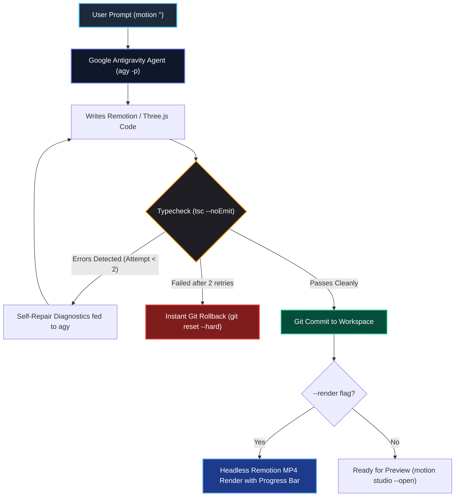

<div align="center">

# ⚡ Motion Studio

### Ultra-Lightweight Prompt-to-Motion-Graphics CLI Engine
**Powered by Google Antigravity CLI (`agy`), Remotion & Three.js**

[](https://nodejs.org)
[](https://remotion.dev)
[](https://threejs.org)
[](https://www.typescriptlang.org)
[]()
[](LICENSE)
[](CONTRIBUTING.md)

<p align="center">
  <a href="#-features">Features</a> •
  <a href="#-quick-start">Quick Start</a> •
  <a href="#-cli-reference">CLI Reference</a> •
  <a href="#-architecture">Architecture</a> •
  <a href="#-showcase-compositions">Compositions</a> •
  <a href="#-contributing">Contributing</a>
</p>

</div>

---

## 💡 Overview

**Motion Studio** is a minimal, blazing-fast CLI engine that turns natural language prompts into production-ready motion graphics and 3D WebGL videos.

- **Zero Framework Bloat:** Stripped of heavy Electron/GUI runtimes — the entire orchestrator compiles in milliseconds to under 30KB of pure Node.js.
- **Autonomous Agent Loop:** Spawns Google's Antigravity CLI (`agy`) directly in an isolated workspace with streaming NDJSON output.
- **Self-Healing TypeScript:** Catches compile errors via `tsc --noEmit` and feeds compiler diagnostics back to the agent for automated repair (up to 2 retries).
- **Git Safety Net:** Auto-commits working animations, cleans untracked code, and rolls back instantly (`git reset --hard & git clean -fd`) if validation fails.
- **Three.js (3JS) 3D GPU Pipeline:** Deterministic 3D WebGL rendering powered by `@remotion/three` and `@react-three/fiber`.
- **Pure Headless Rendering:** Exports pristine MP4s using Remotion's headless Chromium & FFmpeg pipeline with a real-time terminal progress bar.

---

## 🔄 The Autonomous Loop



---

## ⚡ CLI Reference

Run directly with `.\motion` (Windows batch wrapper) or `npm run motion --`:

```bash
# 1. Interactive Google CLI login & account authentication
.\motion login

# 2. Check environment diagnostics, agy binary path, and workspace health
.\motion status

# 3. List all registered compositions in the workspace
.\motion list

# 4. Generate an animation from a prompt
.\motion "Create a vibrant lower third for Sarah Connor with title CTO"

# 5. Targeted edit with frame constraint
.\motion -c TitleCard -f 0-45 "Change text to 'WELCOME' and primary color to cyan"

# 6. Generate AND immediately render to MP4 in one command
.\motion -r "Dynamic logo reveal with light wipe"

# 7. Render any composition headlessly with an ASCII progress bar
.\motion render ThreeDTorus
.\motion render Countdown

# 8. Start Remotion Studio dev server (opens browser only if --open is passed)
.\motion studio --open

# 9. Undo last generation commit
.\motion undo

# 10. View recent generation commits
.\motion history
```

### Headless Render Output Example
```text
╔══════════════════════════════════════════════════════════════╗
║           ⚡ MOTION STUDIO — Google CLI Agent Wrapper        ║
╚══════════════════════════════════════════════════════════════╝

⚡ Rendering composition: ThreeDTorus to MP4...

  [██████████████████████████████] 100%

✅ Render Complete!
  Output file: workspace/out/ThreeDTorus.mp4
```

---

## 🪐 3D Three.js Graphics

Motion Studio features first-class **Three.js (3JS)** integration:

- **Deterministic GPU WebGL:** Camera movements, geometry transformations, and lighting uniforms are computed strictly as mathematical functions of `useCurrentFrame()`.
- **Pre-Bundled 3D Compositions:**
  - **`ThreeDTorus`**: Metallic 3D Torus Knot with dynamic point lights, glowing outer wireframe cage, and physics-based entrance.
  - **`ThreeDCubeGrid`**: Futuristic floating cyber prism cube with glowing emissive core, counter-orbiting gyroscope rings, and real-time HUD coordinates.
- **Interactive Zod Controls:** Adjust wireframe mode, metallic roughness, rotation speeds, and color schemes via typed parameters.

---

## 🎨 Showcase Compositions

| Composition | Type | Description | Key Zod Controls |
| :--- | :---: | :--- | :--- |
| **`TitleCard`** | 2D | Cinematic title card with smooth fade & spring translate | `title`, `subtitle`, `primaryColor`, `accentColor`, `fontSize` |
| **`LowerThird`** | 2D | Broadcast-style lower-third banner sliding from the left | `name`, `title`, `barColor`, `textColor`, `slideDuration` |
| **`KineticText`** | 2D | Staggered pop-in kinetic typography using spring physics | `words`, `primaryColor`, `accentColor`, `staggerDelay` |
| **`LogoReveal`** | 2D | Futuristic horizontal light wipe with scale branding | `brandName`, `glowColor`, `accentColor`, `scaleFrom` |
| **`Countdown`** | 2D | Dynamic 5-second countdown timer with pulsating shockwave rings | `seconds`, `pulseColor`, `ringColor`, `numberSize` |
| **`ThreeDTorus`** | 3D | WebGL metallic 3D torus knot with glowing wireframe shell | `title`, `primaryColor`, `wireframe`, `roughness`, `metalness` |
| **`ThreeDCubeGrid`** | 3D | Cybernetic floating 3D cube with gyroscope orbit rings | `title`, `coreColor`, `accentColor`, `wireframe`, `rotationSpeed` |

---

## 🚀 Quick Start

### 1. Prerequisites
- [Node.js](https://nodejs.org) v18.0.0 or higher (v20+ recommended)
- [Google Antigravity CLI (`agy`)](https://antigravity.google) (Run `.\motion login` once to authenticate)
- [Git](https://git-scm.com) installed and in your PATH

### 2. Installation
```bash
# Clone repository
git clone https://github.com/aaRon1105-11/motion-.git
cd motion-

# Install root dependencies (ultra-lightweight, takes ~3s)
npm install

# Install workspace Remotion & Three.js dependencies
cd workspace && npm install && cd ..

# Build CLI TypeScript
npm run build
```

### 3. Generate Your First Animation
```bash
.\motion "Create a cinematic title card with bold text 'NEXT GEN MOTION'"
```

---

## 📂 Project Structure

```text
motion-studio/
├── .github/
│   ├── workflows/ci.yml       # GitHub Actions automated build & typecheck CI
│   └── ISSUE_TEMPLATE/        # Standardized bug report & feature request templates
├── src/
│   ├── cli.ts                 # Standalone terminal CLI engine
│   ├── agent.ts               # Spawns agy native process with JSON event streaming
│   ├── validate.ts            # TypeScript compiler validator (tsc --noEmit)
│   ├── render.ts              # Headless Remotion MP4 export with progress parser
│   ├── studio.ts              # Remotion Studio server runner (--no-open)
│   └── git.ts                 # Git safety net (auto-init, commit, rollback, undo)
├── workspace/                 # Remotion project workspace (agent playground)
│   ├── AGENTS.md              # Strict agent rulebook & determinism contracts
│   ├── remotion.config.ts     # Video rendering options
│   ├── package.json           # Remotion & Three.js dependencies
│   ├── tsconfig.json          # TypeScript configuration
│   └── src/
│       ├── Root.tsx           # Composition registry
│       ├── index.ts           # Remotion entrypoint
│       └── compositions/      # 2D & 3D Three.js composition templates
├── motion.cmd                 # 1-click Windows CLI wrapper
├── Push-To-GitHub.cmd         # 1-click GitHub push launcher
├── CONTRIBUTING.md            # Guidelines for open-source contributors
├── LICENSE                    # MIT License
├── package.json               # Lightweight root scripts & dev dependencies
└── tsconfig.json              # TypeScript compilation config
```

---

## 🤝 Contributing

Contributions are warmly welcome! Please read our [Contributing Guide](CONTRIBUTING.md) for details on code style, determinism guidelines, and our pull request process.

---

## 📄 License

This project is licensed under the MIT License — see the [LICENSE](LICENSE) file for details.
