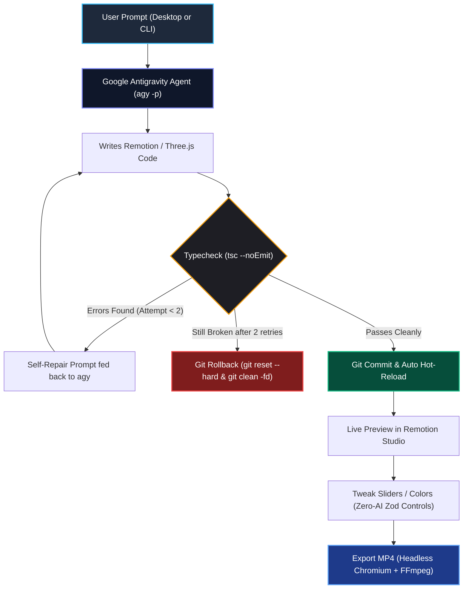
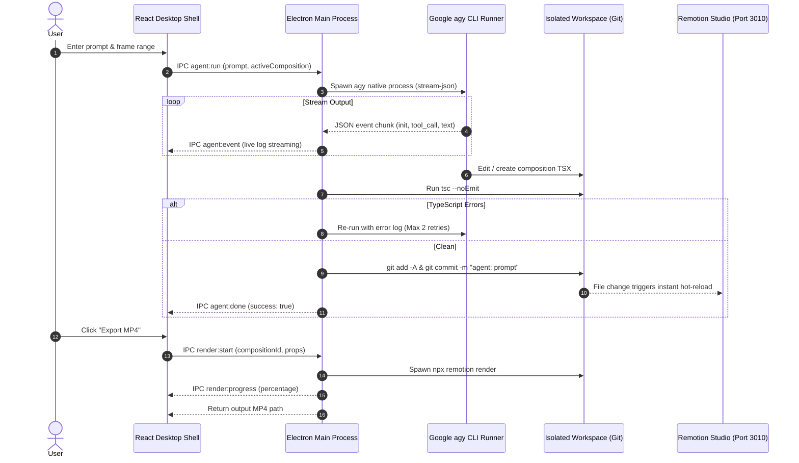

<div align="center">

# ⚡ Motion Studio

### Prompt-to-Motion-Graphics Desktop App & CLI Engine
**Powered by Google Antigravity CLI (`agy`), Remotion & Three.js**

[](https://nodejs.org)
[](https://electronjs.org)
[](https://remotion.dev)
[](https://threejs.org)
[](https://www.typescriptlang.org)
[](LICENSE)
[](CONTRIBUTING.md)

<p align="center">
  <a href="#-quick-start">Quick Start</a> •
  <a href="#-the-core-loop">Core Loop</a> •
  <a href="#-architecture">Architecture</a> •
  <a href="#-cli-engine-motion">CLI Engine</a> •
  <a href="#-3d-threejs-graphics">3D Three.js</a> •
  <a href="#-showcase-compositions">Compositions</a> •
  <a href="#-executable-desktop-app">Desktop App</a>
</p>

</div>

---

## 💡 Overview

**Motion Studio** transforms plain-English prompts into broadcast-quality, deterministic motion graphics and 3D WebGL animations.

1. **Type a Prompt** (e.g. *"A futuristic neon title card with glowing text and light wipe"*).
2. **AI Writes Code** via Google's Antigravity CLI (`agy`) directly into an isolated workspace.
3. **Automated Static Analysis** checks code with `tsc --noEmit`. If errors arise, the agent automatically attempts up to two self-repair cycles; if still failing, Git safely rolls back the workspace.
4. **Instant Live Preview & Auto-Generated Controls** appear in Remotion Studio. Visual values (colors, text, speeds, wireframes) are defined by Zod schemas, letting you tweak the animation in real time without calling an AI model.
5. **Headless MP4 Rendering** exports pristine 60fps/30fps videos via Chromium & FFmpeg with live percentage progress tracking.

---

## 🔄 The Core Loop



---

## 🏛️ Architecture

Motion Studio enforces a strict separation between the desktop UI, the Node host, and the agent workspace:



---

## ⚡ CLI Engine (`motion`)

Motion Studio includes a standalone terminal CLI wrapper that executes the complete generation, validation, and rendering loop without launching Electron:

```bash
# Launch interactive Google CLI login & account check
.\motion login

# Inspect CLI diagnostics, Node version, and workspace health
.\motion status

# List all registered compositions
.\motion list

# Generate an animation from a prompt
.\motion "Create a vibrant lower third for Sarah Connor with title CTO"

# Targeted edit with frame constraint
.\motion -c TitleCard -f 0-45 "Change text to 'WELCOME' and primary color to cyan"

# Generate AND immediately render to MP4 in one command
.\motion -r "Dynamic logo reveal with light wipe"

# Render any composition headlessly with an ASCII progress bar
.\motion render ThreeDTorus
.\motion render Countdown

# Undo last generation commit
.\motion undo

# View recent generation commits
.\motion history
```

### Headless Render Output Example
```text
╔══════════════════════════════════════════════════════════════╗
║           ⚡ MOTION STUDIO — Google CLI Agent Wrapper        ║
╚══════════════════════════════════════════════════════════════╝

⚡ Rendering composition: ThreeDTorus to MP4...

  [██════════════════════════════] 100%

✅ Render Complete!
  Output file: workspace/out/ThreeDTorus.mp4
```

---

## 🪐 3D Three.js Graphics

Motion Studio features first-class **Three.js (3JS)** integration via `@remotion/three` and `@react-three/fiber`:

- **Deterministic GPU WebGL:** Camera movements, geometry transformations, and lighting uniforms are computed strictly as mathematical functions of `useCurrentFrame()`.
- **Pre-Bundled 3D Compositions:**
  - **`ThreeDTorus`**: Metallic 3D Torus Knot with dynamic point lights, glowing outer wireframe cage, and physics-based entrance.
  - **`ThreeDCubeGrid`**: Futuristic floating cyber prism cube with glowing emissive core, counter-orbiting gyroscope rings, and real-time HUD coordinates.
- **Full Inspector Control:** Adjust wireframe mode, metallic roughness, rotation speeds, and color schemes via live sliders.

---

## 🎨 Showcase Compositions

| Composition | Type | Description | Key Zod Controls |
| :--- | :---: | :--- | :--- |
| **`TitleCard`** | 2D | Sleek cinematic title card with smooth fade & spring translate | `title`, `subtitle`, `primaryColor`, `accentColor`, `fontSize` |
| **`LowerThird`** | 2D | Broadcast-style lower-third banner sliding from the left | `name`, `title`, `barColor`, `textColor`, `slideDuration` |
| **`KineticText`** | 2D | Staggered pop-in kinetic typography using spring physics | `words`, `primaryColor`, `accentColor`, `staggerDelay` |
| **`LogoReveal`** | 2D | Futuristic horizontal light wipe with scale branding | `brandName`, `glowColor`, `accentColor`, `scaleFrom` |
| **`Countdown`** | 2D | Dynamic 5-second countdown timer with pulsating shockwave rings | `seconds`, `pulseColor`, `ringColor`, `numberSize` |
| **`ThreeDTorus`** | 3D | WebGL metallic 3D torus knot with glowing wireframe shell | `title`, `primaryColor`, `wireframe`, `roughness`, `metalness` |
| **`ThreeDCubeGrid`** | 3D | Cybernetic floating 3D cube with gyroscope orbit rings | `title`, `coreColor`, `accentColor`, `wireframe`, `rotationSpeed` |

---

## 🚀 Quick Start

### 1. Prerequisites
- [Node.js](https://nodejs.org) v18.0.0 or higher (v20+ recommended)
- [Google Antigravity CLI (`agy`)](https://antigravity.google) (Run `agy` or `.\motion login` once to authenticate)
- [Git](https://git-scm.com) installed and in your PATH

### 2. Installation
```bash
# Clone the repository
git clone https://github.com/your-username/motion-studio.git
cd motion-studio

# Install root dependencies
npm install

# Install workspace dependencies
cd workspace && npm install && cd ..
```

### 3. Launch Development Mode
```bash
# Start both Vite UI dev server and Electron main process with live hot-reload
npm run dev
```

---

## 📦 Executable Desktop App

You can build and run standalone Windows `.exe` executables:

- **1-Click Quick Launcher:** Double-click [`Launch-Motion-Studio.cmd`](Launch-Motion-Studio.cmd) to immediately boot the unpacked binary.
- **Standalone Portable EXE:** Run `npm run build:exe` to produce a single-file `.exe` in `release/` that runs without installation.
- **Windows Setup Installer:** Generates a full NSIS installer package.

```bash
# Package the unpacked directory
npm run build:dir

# Package portable executable and NSIS installer
npm run build:exe
```

---

## 📜 Agent Rulebook (`AGENTS.md`)

The agent is bound by strict contracts defined in [`workspace/AGENTS.md`](workspace/AGENTS.md):

1. **Operating Boundaries:** The agent may only create or modify files inside `src/compositions/` and register them in `src/Root.tsx`.
2. **Deterministic Rendering:** No non-deterministic functions allowed (`Math.random()`, `Date.now()`, `setTimeout()`, CSS transitions, or `THREE.Clock.getElapsedTime()`).
3. **Zod Schema Contract:** Every visual property (colors, text, speeds) must be exposed via a Zod schema and `defaultProps` so the UI can auto-generate controls.
4. **Frame Range Targeting:** When a prompt specifies `[Only affect frames A-B]`, the agent only modifies the `<Sequence />` covering that window.

---

## 📂 Project Structure

```text
motion-studio/
├── .github/
│   ├── workflows/ci.yml       # GitHub Actions automated build & typecheck CI
│   └── ISSUE_TEMPLATE/        # Standardized bug report & feature request templates
├── electron/
│   ├── main.ts                # Electron window lifecycle, Studio runner, IPC handlers
│   ├── preload.ts             # Secure contextBridge API for the UI
│   ├── agent.ts               # Spawns agy native process with JSON event streaming
│   ├── cli.ts                 # Standalone terminal CLI engine
│   ├── validate.ts            # TypeScript compiler validator (tsc --noEmit)
│   ├── render.ts              # Headless Remotion MP4 export with progress parser
│   ├── studio.ts              # Remotion Studio server runner (--no-open)
│   └── git.ts                 # Git safety net (auto-init, commit, rollback, undo)
├── ui/
│   ├── src/
│   │   ├── components/        # PromptPanel, LogPanel, StudioView, ExportButton, StatusBar
│   │   ├── styles/            # Dark-mode UI styling and layout CSS
│   │   ├── types/             # Typed IPC interface definitions
│   │   └── App.tsx            # Main application UI container
│   ├── index.html             # UI HTML shell with webview support
│   └── vite.config.ts         # Vite bundler configuration
├── workspace/                 # Remotion project workspace (agent playground)
│   ├── AGENTS.md              # Strict agent rulebook & determinism contracts
│   ├── remotion.config.ts     # Video rendering options
│   ├── package.json           # Remotion & Three.js dependencies
│   ├── tsconfig.json          # TypeScript configuration
│   └── src/
│       ├── Root.tsx           # Composition registry
│       ├── index.ts           # Remotion entrypoint
│       └── compositions/      # 2D & 3D Three.js composition templates
├── Launch-Motion-Studio.cmd   # 1-click Windows desktop launcher
├── motion.cmd                 # 1-click Windows CLI wrapper
├── CONTRIBUTING.md            # Guidelines for open-source contributors
├── LICENSE                    # MIT License
└── package.json               # Root scripts, build targets & dependencies
```

---

## 🤝 Contributing

Contributions are warmly welcome! Please read our [Contributing Guide](CONTRIBUTING.md) for details on code style, determinism guidelines, and our pull request process.

---

## 📄 License

This project is licensed under the MIT License — see the [LICENSE](LICENSE) file for details.
